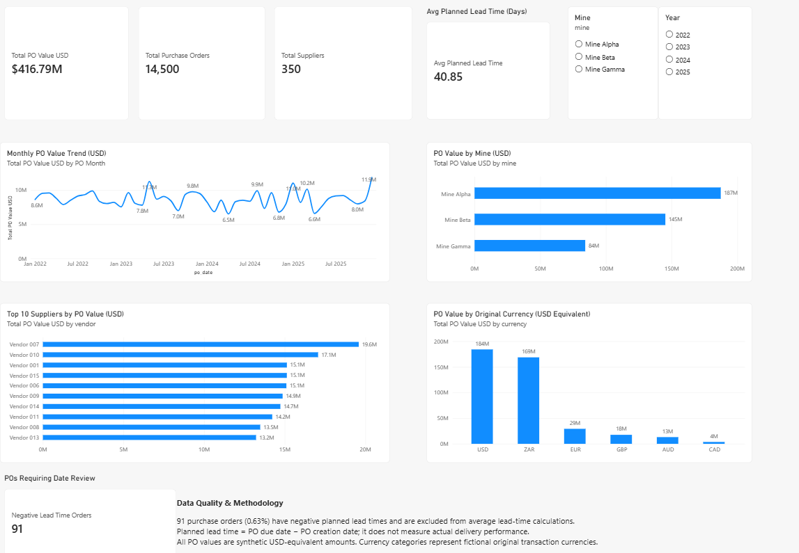

# Procurement Spend & Supplier Analytics | 2022–2025

### SQL • PostgreSQL • Power BI • DAX

## Project Overview

An end-to-end procurement analytics portfolio project analysing 14,037 purchase orders dated February 2022 to December 2025 across three anonymised mining operations.

The project demonstrates data preparation, SQL-based analysis, data-quality validation and interactive Power BI reporting.

## Dashboard Preview



## Key Metrics

| Metric | Result |
|---|---:|
| Purchase Orders | 14,037 |
| Total PO Value (USD Equivalent) | $588.01M |
| Unique Suppliers | 933 |
| Average Planned Lead Time | 40.12 days |
| Negative Planned Lead-Time Records | 77 (0.55%) |

## Business Questions

- How is purchase order value distributed across mining operations?
- Which suppliers account for the highest purchasing value?
- How does monthly purchasing activity change over time?
- How does USD-equivalent PO value vary by original transaction currency?
- How do planned procurement lead times compare across mining operations?

## Key Findings

**Mine comparison:** Mine Alpha accounts for approximately $344M in purchase order value, followed by Mine Gamma ($123M) and Mine Beta ($121M).

**Supplier concentration:** The largest supplier accounts for approximately $86M in purchase order value.

**Monthly trends:** Purchasing value fluctuates significantly, with a notable peak of approximately $32M in late 2023.

**Currency mix:** USD-originated orders represent the largest share of total USD-equivalent PO value.

**Lead-time analysis:** Average planned lead times are approximately 43.5 days for Mines Alpha and Gamma, compared with 35.8 days for Mine Beta.

## Data Preparation & Quality

The project uses a three-layer PostgreSQL architecture:

1. **Raw:** Preserves imported source records.
2. **Staging:** Standardises data types, currency labels and calculated fields.
3. **Analytics:** Uses SQL queries to answer procurement business questions.

A total of 77 records with negative planned lead times were flagged and excluded from lead-time statistics without being deleted.

**Methodology:** Planned lead time is calculated as PO due date minus PO creation date. It does not measure actual supplier delivery performance.

All monetary values represent USD-equivalent purchase order values. Currency categories refer to the original transaction currency, not the currency of the reported monetary amount.
### Currency Normalisation

The source dataset contains purchase orders originally issued in six currencies: USD, ZAR, EUR, AUD, CAD and GBP.

All monetary values used in this analysis were already converted to USD in the source export. The original transaction currency was retained as a separate field to enable analysis of purchasing activity by currency.

Consequently, all reported purchase-order values, including the $588.01M portfolio total, are expressed in USD-equivalent amounts. No additional currency conversion was performed in SQL or Power BI.

## Tools & Technologies

- PostgreSQL 17 and pgAdmin 4
- SQL: aggregations, grouping, conditional logic, subqueries, date functions and percentile calculations
- Power BI Desktop
- DAX: KPI measures, calculated columns and filtered aggregations
- Visual Studio Code

## Project Structure

```text
Procurement-Spend-Analytics/
├── dax/
│   └── measures.dax
├── powerbi/                 # PBIX excluded from public repository
├── screenshots/
│   └── dashboard_overview.png
├── sql/
│   ├── analytics/
│   │   ├── 07_spend_by_mine.sql
│   │   ├── 08_spend_by_vendor.sql
│   │   ├── 09_spend_by_currency.sql
│   │   ├── 10_monthly_spend.sql
│   │   └── 11_lead_time_analysis.sql
│   ├── 01_create_schemas.sql
│   ├── 02_create_raw_tables.sql
│   ├── 03_import_csv.sql
│   ├── 04_load_raw.sql
│   ├── 05_create_staging.sql
│   └── 06_data_quality_checks.sql
└── README.md
```

## Data Availability

### Data Availability

The underlying purchase-order dataset is not publicly distributed to protect confidential business information.

The Power BI `.pbix` file is also excluded from the public repository because it contains imported row-level data.

The repository includes SQL scripts, DAX measures, project documentation and a dashboard screenshot to demonstrate the analytical methodology and reporting capabilities.

## Future Improvements

- Supplier concentration and Pareto analysis
- Year-over-year procurement value comparisons
- Additional data-quality checks
- Supplier performance analysis using actual delivery dates when available
