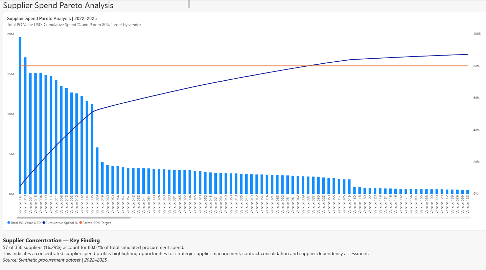

# Procurement Spend & Supplier Analytics | 2022–2025

### SQL • PostgreSQL • Power BI • DAX

## Project Overview

An end-to-end procurement analytics portfolio project using a fully synthetic dataset of 14,500 purchase orders across three fictional mining operations from 2022 to 2025.

The dataset was independently generated using Python to simulate realistic procurement patterns, including multi-currency purchasing, supplier concentration, spend variation and planned lead times.

The project demonstrates data generation, PostgreSQL data modelling, SQL-based analysis, data-quality validation, Power BI dashboard development and supplier Pareto analysis.

All purchase-order records, suppliers, mining operations and financial values are fictional. The published project does not use original company transaction records.

## Dashboard Preview

### Procurement Overview Dashboard


### Supplier Spend Pareto Analysis



## Key Metrics

**Purchase-order grain:** Each staging-table record represents one distinct purchase order. The synthetic dataset contains 14,500 purchase orders, with one record per purchase order.

| Metric | Result |
|---|---:|
| Purchase Orders | 14,500 |
| Total PO Value (USD Equivalent) | $416.79M |
| Unique Suppliers | 350 |
| Average Planned Lead Time | 40.85 days |
| Negative Planned Lead-Time Records | 91 |
| Period | 2022–2025 |

## Business Questions

- How is purchase order value distributed across mining operations?
- Which suppliers account for the highest purchasing value?
- How does monthly purchasing activity change over time?
- How does USD-equivalent PO value vary by original transaction currency?
- How do planned procurement lead times compare across mining operations?

## Key Findings

**Mine comparison:** Purchase-order value is analysed across three fictional mining operations to identify differences in purchasing activity and value distribution.

**Supplier concentration:** Supplier Pareto analysis shows that 57 of 350 suppliers (16.29%) account for 80.02% of total simulated procurement spend.

**Monthly trends:** Monthly purchase-order value fluctuates throughout 2022–2025, demonstrating variations in simulated procurement activity.

**Lead-time analysis:** The synthetic dataset has an overall average planned lead time of 40.85 days, excluding 91 records with negative planned lead times. Planned lead time measures the interval between purchase order creation and the expected due date, not actual supplier delivery performance.

## Data Preparation & Quality

The project uses a three-layer PostgreSQL architecture:

1. **Raw:** Preserves imported source records.
2. **Staging:** Standardises data types, currency labels and calculated fields.
3. **Analytics:** Uses SQL queries to answer procurement business questions.

A total of **91 purchase orders (0.63%)** have negative planned lead times. These records were flagged for data-quality review and excluded from average lead-time calculations without being deleted from the dataset.

**Methodology:** Planned lead time is calculated as PO due date minus PO creation date. It does not measure actual supplier delivery performance.

### Currency Normalisation

The project uses a fully synthetic procurement dataset. Purchase-order values are represented in USD-equivalent amounts, while the original transaction currency is retained for comparative analysis.

All reported spending figures, including the $416.79M total purchase-order value, are expressed in USD-equivalent terms. No additional foreign exchange conversion is performed in the SQL analysis or Power BI dashboard.

## Tools & Technologies

- PostgreSQL 17 and pgAdmin 4
- SQL: aggregations, grouping, conditional logic, subqueries, date functions and percentile calculations
- Power BI Desktop
- DAX: KPI measures, calculated columns and filtered aggregations
- Visual Studio Code

## Project Structure

```text
Procurement-Spend-Analytics/
├──scripts/
|   └── generate_synthetic_data.py
├── dax/
│   └── measures.dax
├── powerbi/                 # PBIX excluded from public repository
├── screenshots/
│   └── dashboard_overview.png
|   └── supplier_pareto.png
├── sql/
│   ├── analytics/
│   │   ├── 07_spend_by_mine.sql
│   │   ├── 08_spend_by_vendor.sql
│   │   ├── 09_spend_by_currency.sql
│   │   ├── 10_monthly_spend.sql
│   │   └── 11_lead_time_analysis.sql
|   |   └── 12_supplier_pareto_analysis.sql
│   ├── 01_create_schemas.sql
│   ├── 02_create_raw_tables.sql
│   ├── 03_import_csv.sql
│   ├── 04_load_raw.sql
│   ├── 05_create_staging.sql
│   └── 06_data_quality_checks.sql
└── README.md
```

## Data Availability

The dataset is fully synthetic and reproducible using scripts/generate_synthetic_data.py.

The project generates 14,500 fictional purchase orders covering 350 suppliers and three fictional mining operations.

The Power BI .pbix file is excluded from the repository. SQL scripts, DAX measures, Python generation code and anonymised dashboard screenshots are provided to demonstrate the analytical workflow.

## Supplier Pareto Analysis

Supplier spend concentration was analysed using SQL window functions and Power BI DAX measures.

**Key findings from the complete synthetic dataset:**

- Total suppliers: **350**
- Suppliers accounting for approximately 80% of spend: **57**
- Share of supplier base: **16.29%**
- Cumulative spend represented: **80.02%**

The analysis demonstrates how supplier concentration can inform strategic sourcing priorities, supplier relationship management and dependency-risk assessments.

The Power BI Pareto visual includes supplier spend rankings, cumulative spend percentages and an 80% reference line.

## Future Improvements

- Supplier segmentation and concentration risk scoring
- Year-over-year procurement value comparisons
- Additional data-quality checks
- Supplier performance analysis using actual delivery dates when available

## How to Reproduce This Project

### 1. Generate the Synthetic Dataset

The project includes a Python script that generates fictional procurement records for analysis.

Run the following command from the project root:

```bash
python scripts/generate_synthetic_data.py

```

### 2. Prepare the PostgreSQL Database

Create a PostgreSQL database and execute the following scripts in order:

1. `sql/01_create_schemas.sql`
2. `sql/02_create_raw_tables.sql`
3. `sql/03_import_csv.sql`
4. `sql/04_load_raw.sql`
5. `sql/05_create_staging.sql`
6. `sql/06_data_quality_checks.sql`

Import the generated synthetic CSV into the import table using the procedure described in `03_import_csv.sql` before executing `04_load_raw.sql`.

### 3. Run the Analytical Queries

Execute the SQL scripts in `sql/analytics/` to explore procurement spend, supplier concentration, monthly trends, currency distribution and planned lead times.

### 4. Explore the Power BI Results

The `screenshots/` folder contains the procurement dashboard and supplier Pareto visualisation.

The `dax/measures.dax` file documents the DAX measures used in the analysis.

Power BI `.pbix` files are excluded from the repository.